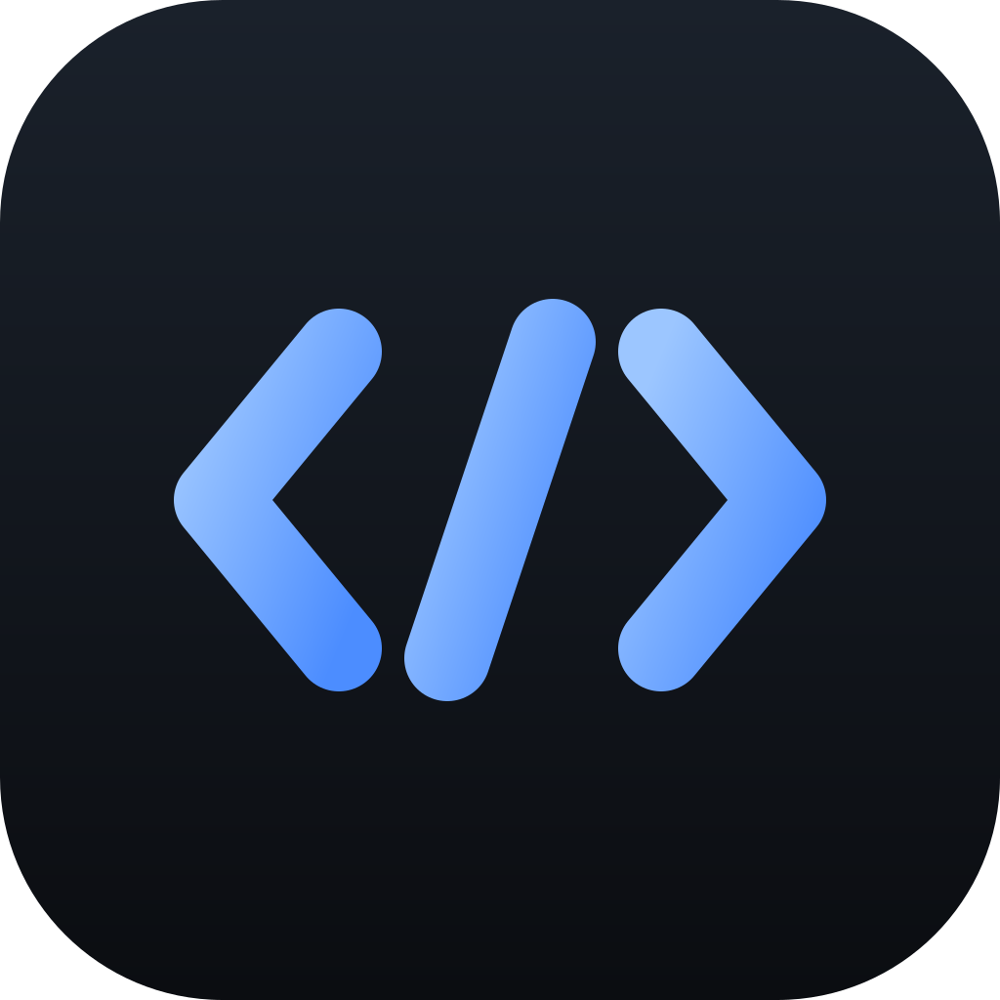
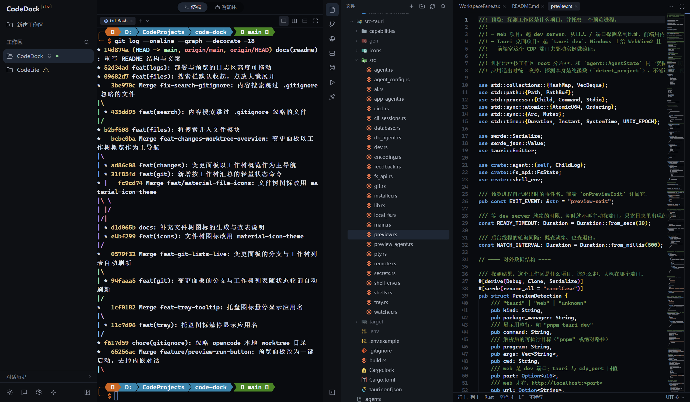

<p align="center">
  
</p>

<h1 align="center">CodeDock</h1>

<p align="center"><b>把散落一地的开发现场，收拢进一个窗口。</b></p>

<p align="center">一个开发者的 AI 编程驾驶舱 —— 终端、编辑器、Git、远程、数据库、预览、部署，同在一片甲板上各就各位。</p>

<p align="center">
  <a href="LICENSE"></a>
  
  
</p>

---

## 一个不大的执念

写代码本该是件专注的事。可现实里，它更像在七八个窗口之间反复横跳：

一个终端跑着命令，一个编辑器改着文件，文件管理器找着路径，Git 客户端看着 diff，数据库工具连着库，SSH 客户端开着服务器，浏览器预览着页面……它们各自为政，彼此不通气。真正写代码的时间，被「找窗口」和「切上下文」吃掉了大半。

CodeDock 想做的，是让这些各据一方的工具，重新回到同一片甲板上。

名字里的 **Dock** 是双关：它既是**船坞**——每个项目都能安稳靠岸，来回切换不必重启世界；也是**驾驶舱**——你坐在正中，一屏之内看清全局，伸手就是你要的一切。

它不要求你登录，不替你把代码送上云，也不打算变成又一个需要你伺候的庞然大物。它只把该在一起的放在一起，然后把注意力还给你。

---

## 几条不肯让步的取舍

一份产品介绍，说到底是在交代它的取舍。以下是 CodeDock 的取舍。

**终端是一等公民。**
不是 IDE 角落里那个「能跑命令的小窗」，而是真正的 PTY（Windows 上走 ConPTY）：多标签各自独立，可左右或上下并列，切走照跑。因为你真正的工作，多半就发生在命令行里。

**注意力，是最不该被浪费的资源。**
多工作区并行时，最容易出事的就是「后台的某个智能体停下了，而你没看见」。谁在跑、谁在等、谁已经跑完，CodeDock 都把标记亮在你眼睛会经过的地方。

**AI 是副驾驶，方向盘始终在你手里。**
同一个工作区，终端里的 TUI 式智能体与对话面板里的 GUI 式智能体共用一套现场，一键换手，改动都直接落盘。它替你打字，但你看得见每一步，也随时能接管。

**本地优先，你的代码与密钥不出这台机器。**
编辑器内核与终端全在本地；AI 密钥进操作系统凭据库，前端拿不到明文。断网也能写代码，不必等一朵云。

**克制，是高级感的来源。**
不加没有实际功能的元素。宁留空，也不放装饰性提示、假快捷键、占位状态。

---

## 一屏之内

<p align="center">
  
</p>

<p align="center"><sub>终端、文件树、编辑器与 Git 同屏；分栏皆可拖动</sub></p>

左边是项目与会话，中间是终端与智能体，右侧一条图标条切换七个模块：**文件 / 变更 / 浏览器 / 远程连接 / 数据库 / 预览 / 部署**。分栏都能拖动，重要的时候可以整块全屏，按 `Esc` 退回。

---

## 它能做什么

### 一个窗口，多条战线

一个工作区可以包含多个工作目录，文件树并列展示，文件名搜索、内容搜索与 Git 变更按目录分组；终端与智能体使用工作区的活动根目录。

侧栏负责创建、编辑、切换、关闭和移除工作区，可置顶。列表按「最近活动」自动排序——终端与智能体用得最多的排在最前，置顶的固定在最上。新建时可以直接打开本地目录，也可以从 Git 仓库克隆（可选分支、浅克隆，进度实时显示）。启动时回到上次的工作区；移除只删除 CodeDock 里的记录，不动磁盘文件。

**切换工作区不重启世界。** 终端不杀、智能体不停，编辑器标签、撤销历史与文件树展开态原样保留；只有关闭工作区，才会真正结束它的终端与智能体服务。

### 谁在等你

要你批准权限、要你回答问题、终端 CLI 停在交互提示上，或是一轮任务已经跑完在等你下一步——侧栏工作区行、终端标签栏和对话列表会同时亮起标记。点一下，直接回到那个工作区、那个标签、那段会话。

多工作区并行的意义，不是「同时开很多」，而是「不必盯着每一个」。

### 终端，一等公民

真实 shell，真实 PTY，xterm.js 渲染并启用 WebGL 加速。多标签、每个标签一个独立会话，也支持左右并列与上下并列；切走的会话仍在后台跑。终端程序按平台探测：Windows 上的 pwsh / cmd / WSL / Git Bash，macOS / Linux 上的 zsh / bash / fish / nushell……标签上带各自的品牌图标。

终端里的操作按你肌肉记忆来：`Ctrl+C` 有选区时复制、无选区时仍是中断；`Ctrl+V` 或右键粘贴，多行内容按 bracketed paste 送进 shell——粘一段代码，不会一行行自己跑掉。

侧栏可以直接启动配置好的 AI CLI，也能翻看 CodeBuddy / Claude Code / Codex / opencode 的历史会话，点开就在新终端标签里接着聊。

编辑器里选中的文本，能带着 `路径:行号` 直接送进终端或智能体输入框；改完哪里、从哪看起，一句话都不用解释。

### 编辑器 · VS Code 的内核，离线的心

Monaco（VS Code 的内核），完全离线。多标签、`Ctrl+S`，打开的文件被外部改动会自动重读；但外部重读不会覆盖你尚未保存的编辑。

打开文件时自动识别编码（UTF-8 / UTF-16 / GBK / Big5 等），保存按同一编码写回——GBK 老工程里的中文不会被写成乱码。识别有误时，状态栏随时可以手动切换，并从磁盘重读。

**markdown 右上角三档切换：预览 / 编辑 / 对照**，默认预览。预览是成稿的样子，对照是左边源码、右边渲染，边改边看；支持 HTML 标签与 KaTeX 数学公式（`$...$` 行内、`$$...$$` 块级）。svg、html / htm、图片、PDF 打开即渲染，想改再切回编辑。

自动保存支持延迟（默认停手 1 秒）、失焦、切窗口或关闭时保存，随你习惯；自动换行默认开启，可在设置里关掉。

### 文件与搜索 · 一个模块，两种找法

搜索栏默认收起，点标题栏的放大镜才展开；展开后，一个关键词，右侧切换「名称 / 内容」：

- **名称**：按文件名过滤文件树，命中的目录自动展开；清空即回到完整目录树。
- **内容**：在整个工作区里搜，支持区分大小写、全字匹配、正则、包含 / 排除 glob，可单处或全部替换。

文件树里能新建、重命名、删除，复制 / 剪切 / 粘贴跨目录移动，多选批量操作，拖拽移动，复制路径，加入 `.gitignore`；右键网页文件可以丢进内置浏览器预览。工作区被外部改动时自动刷新。

### 变更 · 看得见每一步 Git

状态标记（改动 / 新增 / 删除 / 冲突），暂存、取消暂存、放弃修改，都能细到**逐块甚至逐行**；改动列表支持列表与树形两种视图，点开是只读的内联差异。暂存差异比较 HEAD 与暂存区，未暂存差异比较暂存区与工作区。

提交历史是一条图形化泳道图：悬停看单次改动规模，按主题 / 作者 / 路径过滤，一键回到 HEAD。标题栏有获取 / 拉取 / 推送，也会顺手处理分支切换与新建、worktree 切换、修正或撤销上一次提交、stash 储藏。

本地与远程分叉时可以合并；发生冲突后，手动编辑文件并暂存，再「完成合并」，也可以「中止合并」。工作目录还不是 git 仓库时，面板里点一下就能初始化（默认分支 `main`）。

AI 能解释一段改动改了什么，也能替你起草提交信息——最后按不按下去，仍然是你的事。

### 右栏七件事

一条图标条，七个模块。每个模块都跟着当前工作区走，切走不丢现场。

**浏览器**
iframe 内嵌本地服务，改完文件点「重新加载」就能看到新效果。文件树里右键网页文件也能丢进来，相对路径引用的 css / js / 图片一并加载。加载走 Tauri 的 asset 协议，只放行打开过的工作目录。

**远程连接**
SSH 与 SFTP 同屏。多台主机、每台可开多个交互式终端；也可以切到左右双文件面板，左边本地、右边远程，选中即传，文件或整个目录都能直接拖到对侧，目录递归复制，本地窗格跟随外部改动刷新。凭据存系统钥匙串。

**数据库**
MySQL / PostgreSQL / SQLite，密码进系统钥匙串。浏览表与视图、点开看数据、切到「结构」看列 / 索引 / 外键 / 建表 DDL；也能写 SQL —— Monaco 语法高亮、按方言一键美化、服务端翻页，结果可导出 CSV 或 Excel。

「Agent」子页把查询交给对话：一句话说清想查什么，它自己看表与字段、写 SQL、执行，结果就地铺成表格。**只读**——写数据或改结构的语句一律拒绝。

**预览**
面板里只有一个「启动」按钮。内置的预览助手先探测项目类型，再决定怎么起：Web 项目起 dev server、就绪后内嵌预览；Tauri 项目起带 CDP 调试端口的实例，端口直接报给你。起不来时它读日志、看脚本，能靠改命令或端口解决的就重试一次，其余给出诊断与改动建议。

进程由后端托管：切走工作区、收起面板都不影响它；点「停止」或退出应用时统一清理。

**部署**
读项目根的 `.local-cicd.yaml`，一键在本机跑 **Preflight → Build → Deploy → Verify**（失败时追加 Rollback），逐阶段显示进度、耗时与实时日志，失败即停。配置可以直接编辑 YAML，也可以「按项目探测」生成建议，或让 AI 依项目标记起草一份草稿；跑挂了点「AI 诊断」，把阶段、命令和日志交给模型分析。

部署不必先上一整套 CI 基建——配置驱动、单机单环境、失败即停，就是它的全部野心。

### 智能体 · 副驾驶，方向盘在你手里

终端区顶栏是 **TUI / GUI** 双入口。左边是真正的终端，各类 CLI agent 原样运行；右边是 **opencode** 驱动的对话面板，实时渲染助手正文与工具调用，改动直接落到工作区。同一个工作区，两种方式随时换手。

智能体配置分两层：**全局层**所有工作区共享；**本工作区层**写到仓库根的 `.codedock/`，`rules.md`、`memory.md`、`skills.json`、`agents.json` 随仓库走、能进 git，也能直接用编辑器改。工作区层覆盖同名全局项。

另外两位内置助手，各管一段：

- **应用助手**（侧栏设置旁进入）：问答 CodeDock 自己的用法，也能按指令改设置、管工作区、切右栏模块。不可逆操作会先弹确认。
- **预览助手**（点「启动」时在背后忙的那位）：探测、启停、读日志、诊断纠错。它能看代码，但不改代码——要改，得你来。

要用对话式智能体，需自行安装 [opencode](https://opencode.ai) 并在设置里配置兼容 OpenAI 协议的提供商、接口地址、密钥与模型。关掉开关，就完全回到纯终端。

### 主题、设置与托盘

深色 / 浅色 / 跟随系统，外加十余套配色（VS Code、One Dark、Dracula、Nord、Tokyo Night…）。设置分为**外观 / 终端 / 编辑器 / 快捷键 / 智能体 / 依赖**六页，字体、字号、自动换行、自动保存、右栏模块显隐都可调，快捷键也能自己录。

有工作区打开时，关闭窗口可以选择退出或最小化到托盘；驻留期间会话继续运行，再次启动会唤回已有窗口。开发版与安装版可以并存，开发版带 `dev` 徽章。

---

## 写在最后

工具越做越多，窗口越开越乱。CodeDock 不打算再添一个需要你伺候的窗口——它只是把已有的那些，摆回该在的位置。

如果它能让你少找一次窗口、少丢一次上下文，那它就没有白做。

---

## 安装与运行

已打包的版本在 [Gitee Releases](https://gitee.com/silicon-atom/code-dock/releases) 下载，使用它不需要 Rust 或 pnpm。

| 方式 | 适合谁 |
| --- | --- |
| **Windows 安装包** `CodeDock_<版本>_x64-setup.exe` | 常规安装，开始菜单与托盘 |
| **macOS 安装包** `CodeDock_<版本>_aarch64.dmg` | Apple Silicon |
| **源码构建** | 想改它、或想自己打包的人 |

```bash
pnpm install
pnpm tauri dev                       # 开发
pnpm tauri build                     # 打包安装包
```

从源码构建需要 Rust、Node.js、pnpm，以及对应平台的 Tauri 2 原生构建依赖（Windows 的 C++ 构建工具与 WebView2、macOS 的 Xcode Command Line Tools、Linux 的 WebKitGTK 等）。

Windows 需要 WebView2 Runtime（Windows 11 自带）；Git 功能需要安装 Git；AI CLI 需要各自安装。**「设置 → 依赖」**可以检测 Git、Node.js、opencode、Codex、CodeBuddy、Claude Code 与 Gitee CLI 的安装状态，并提供安装入口。

---

## 快捷键

| 快捷键 | 作用 |
| --- | --- |
| `Ctrl+S` | 保存当前文件 |
| `Ctrl+Enter` | 在提交信息框里提交 |
| `Ctrl+C` / `Ctrl+X` / `Ctrl+V` | 文件树：复制 / 剪切 / 粘贴（焦点在树内某一行时） |
| `Ctrl+C` / `Ctrl+V` | 终端：有选区复制，无选区 `Ctrl+C` 仍是中断；粘贴走 `Ctrl+V` |
| `Ctrl+W` | 终端 / 编辑器：关闭当前标签页 |
| `Ctrl+Shift+T` | 终端（本地 / 远程）：新建一个终端标签页 |
| 鼠标右键 | 终端：有选区复制，无选区粘贴 |
| `Esc` | 退出全屏 / 关闭弹窗 |

终端里正在跑**全屏程序**（CodeBuddy CLI、Claude Code、vim、less…）时，`Ctrl+W` / `Ctrl+Shift+T` 会原样让给它们——这些程序自己要用。回到 shell 提示符后又恢复成上面的行为。键位都能在设置里改。

---

## 已知边界

我们把边界写在这里，而不是藏起来：

- **Git 不做的事**：`reset --hard`、force push、自动解决合并冲突、任意两个提交间对比（只能看「提交 vs 父提交」）、自动识别嵌套子仓库。
- **数据库 Agent 只读**：写数据、改结构的语句一律拒绝。它负责把「查什么」变简单，不负责替你动数据。
- **预览助手不改代码**：它能把项目跑起来、能诊断原因，但改动建议只停在建议。
- **部署是单机的**：配置驱动、单机单环境、失败即停，不是通用 CI 的替代品。
- **编码识别可能猜错**：状态栏可以手动切换并从磁盘重读；外部重读不会覆盖未保存内容。
- **切换保留现场，关闭才会收摊**：切走的工作区在后台照跑，关闭工作区才会结束它的终端与智能体。
- **工作区不提供手动排序**：列表按最近活动自动排列，置顶固定在最上——排序交给使用习惯，不交给维护成本。

---

## 关于 CodeDock 本身

CodeDock 用 Rust + Tauri 2 构建，前端是 React + TypeScript + Tailwind，编辑器用 Monaco，终端用 xterm.js。没有账号，没有云同步，能离线就离线。

<details>
<summary>开发与验证</summary>

```bash
pnpm build                          # 前端类型检查与构建
cd src-tauri
cargo test --lib                    # 后端单测
cargo clippy                        # Rust 静态检查
```

界面验证可使用 `scripts/cdp-check.cjs` 连接 WebView2 的 CDP 端口；指定窗口时用 `target` 标题片段。用 CodeDock 开发自身时，开发服务器的 HMR 会重载界面并重置终端与编辑器，建议在另一个工作区里运行开发命令。

版本号以 `package.json` 为来源，通过 `pnpm version patch|minor|major` 更新。界面显示 `<版本号>+<Git 短 hash>[.dirty]`，`.dirty` 表示构建包含未提交改动，安装包版本仍为纯数字。

</details>

<details>
<summary>项目结构</summary>

```
src/                  React 前端
  App.tsx             三段式布局装配
  components/         工作区 / 终端 / 文件树与搜索 / 编辑器 / 变更 / 浏览器 /
                      远程连接 / 数据库 / 预览 / 部署 / 智能体 / 设置
  lib/                Context 与薄封装：主题、设置、pty / fs / git / ai /
                      agent / preview / remote / database / cicd
src-tauri/src/        Rust 后端
  lib.rs              命令注册与 state
  pty.rs, shells.rs   终端会话与 shell 候选探测
  fs_api.rs           文件读写 + 路径沙箱 + 搜索
  git.rs              git 状态 / 暂存 / 时间线 / 差异 / 远程操作
  ai.rs, agent.rs     大模型调用、opencode 后端
  preview.rs          预览：项目探测与预览进程池
  remote.rs           SSH 终端 + SFTP 传输
  database.rs         数据库连接池与查询
  app_agent.rs        应用助手：界面操作的 MCP 工具服务
  preview_agent.rs    预览助手：探测 / 启停预览的 MCP 工具服务
  secrets.rs          操作系统凭据库中的 API 密钥
```

关键的几条实现取舍：工作区内的文件访问全部校验边界；凭据只进系统凭据库，前端拿不到明文；预览与智能体的进程池按工作区 root 分片，切走工作区不杀、退出应用统一清理；「操作对象在前端」的 MCP 工具走文件邮箱桥，子进程写请求、前端轮询执行、再写回结果。

</details>

---

## 许可

[Apache License 2.0](LICENSE)
