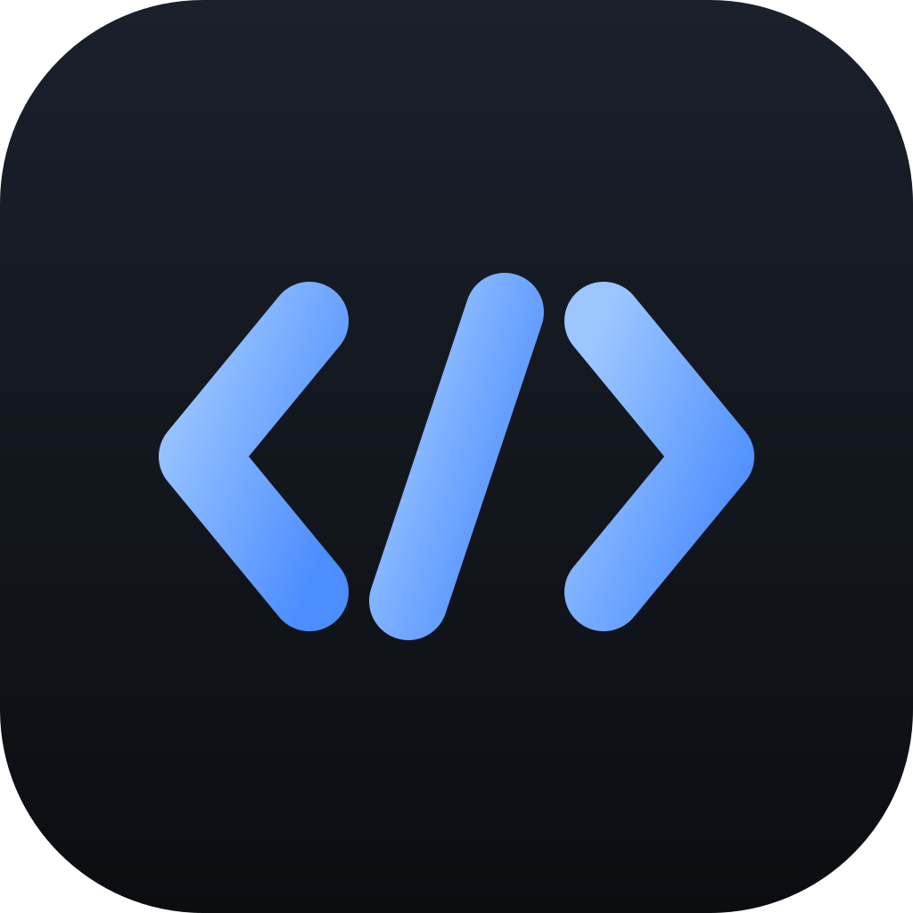
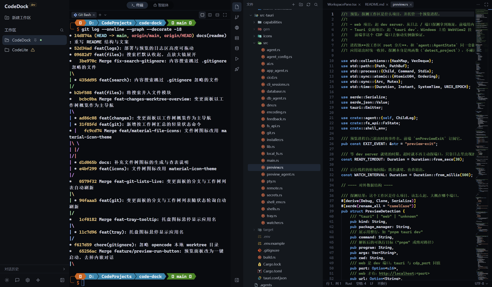

<p align="center">
  
</p>

<h1 align="center">Codovo</h1>

<p align="center"><b>Bring your scattered development work into one window.</b></p>

<p align="center"><a href="README.zh-CN.md">简体中文</a></p>

<p align="center">An AI coding cockpit for developers — terminal, editor, Git, remote hosts, databases, previews, and deployment, all on the same deck.</p>

<p align="center">
  <a href="LICENSE"></a>
  
  
</p>

---

## One small obsession

Writing code should be focused work. In practice, it often means jumping between a terminal, editor, file manager, Git client, database tool, SSH client, and browser preview. They each keep their own context, and too much time goes into finding windows and getting back up to speed.

Codovo brings these tools back onto one deck. Its Chinese name, **码坞 (Mǎwù)**, combines “code” with “dock”: each project can pull in, stay ready, and switch without restarting the world. It is also a cockpit: keep the whole scene in view and the tools within reach.

Codovo does not require an account, send your code to the cloud, or ask you to maintain another heavyweight tool. It puts the pieces together and gives your attention back to the work.

---

## A few non-negotiable choices

**The terminal is a first-class citizen.** This is a real PTY (ConPTY on Windows), not a small command window tucked into an IDE. Tabs have independent sessions, can be split side by side or top and bottom, and keep running in the background.

**Attention is too valuable to waste.** When an AI CLI pauses for approval or input, or finishes a task, Codovo marks it where you are likely to see it.

**AI is a copilot; you keep the wheel.** Terminal AI CLIs and the app assistant share the same workspace. Changes go directly to disk, and you can inspect or take over at any point.

**Local first. Your code and credentials stay on this machine.** The editor and terminal run locally. AI credentials go into the operating system credential store. You can keep coding offline.

**Restraint is part of the design.** Codovo avoids decorative controls, fake shortcuts, and placeholder states. Empty space is better than UI without a purpose.

---

## One screen

<p align="center">
  
</p>

<p align="center"><sub>Terminal, file tree, editor, and Git in one view; split panes are resizable.</sub></p>

The left sidebar holds workspaces and session history. The center is a shared work area with terminal sessions, ACP chats, files, browser pages, and other content in super tabs. The right icon rail opens contextual panels for files, changes, remote connections, databases, preview, and deployment. Select actual content to open it in a center tab. Panes can be resized or taken fullscreen; press `Esc` to return.

---

## What it can do

### One window, several workstreams

A workspace can include multiple working directories. File trees appear side by side, and search and Git changes are grouped by directory. Terminals and assistants use the active root. When an AI CLI starts from the Agent panel, a super-tab menu, or workspace history, the other directories are passed using the CLI's supported options (such as `--add-dir` or `--include-directories`) or configuration (such as opencode's `external_directory`), keeping its access scope aligned with the workspace.

The sidebar creates, edits, switches, closes, and removes workspaces. Pin them or put them into groups. Groups become section headings that can be collapsed, reordered, renamed, or deleted; deleting a group moves its workspaces to the ungrouped section. Workspaces are sorted by recent activity, with pinned workspaces first. Create a workspace from a local directory or clone a Git repository with optional branch selection and shallow cloning. Startup can restore the last workspace. Removing a workspace only removes its Codovo entry; files on disk are untouched.

Drag a workspace onto a group to move it, or onto the ungrouped section to remove it from a group. Press `Esc` to cancel a drag. Pinned workspaces stay in the pinned section after regrouping.

**Switching workspaces does not restart the world.** Terminals and assistants keep running; editor tabs, undo history, and expanded file-tree state stay in place. Closing a workspace ends its terminal and assistant services.

### See who needs you

Codovo marks a workspace and its terminal or ACP tab when an agent needs approval or input, a CLI is waiting at an interactive prompt, or a task has finished. Click the marker to return to that workspace and session.

The point of multiple workspaces is not to watch more things at once. It is to stop having to watch each one.

### Terminal first

Use a real shell and PTY, rendered with xterm.js. Sessions have independent tabs and can be split horizontally or vertically. Supported shells are detected by platform: pwsh, cmd, WSL, and Git Bash on Windows; zsh, bash, fish, and nushell on macOS and Linux. Tabs show each CLI's brand icon.

Terminal shortcuts follow familiar conventions: `Ctrl+C` copies when text is selected and interrupts otherwise. `Ctrl+V` or right-click pastes. Multiline text uses bracketed paste so a pasted code block does not execute line by line.

Every terminal is a super tab. Agent-launched sessions show the CLI's brand icon. The right Agent panel selects a terminal or ACP chat and can switch between CodeBuddy, Claude Code, Codex, opencode, and other agents. The `+` menu creates a terminal, an Agent terminal, or an ACP chat. Each ACP chat has its own super tab.

Expand a workspace's session history to browse CodeBuddy, Claude Code, Codex, and opencode conversations. Selecting one resumes it in a new terminal tab.

Selected editor text can be sent to a terminal or the app assistant along with its `path:line` location.

### Editor — VS Code's core, offline

Monaco (the VS Code editor core) runs fully offline. File viewing reuses one active super tab: opening another file switches its content instead of consuming another tab. `Ctrl+N` creates an untitled buffer. The status bar shows line and column, file size, selection length, and path (click to copy the absolute path), as well as read-only, large-file, and truncation markers. Closing a dirty file asks whether to save, discard, or cancel.

When an open file changes outside Codovo, clean content syncs automatically. Unsaved edits are never overwritten; the tab gets a conflict marker. Deleted files are marked too. Tab context actions can reload from disk or keep local edits. Discarding changes returns to the disk version or latest save snapshot.

Files are detected and saved with their original encoding (UTF-8, UTF-8 BOM, UTF-16, GBK, GB18030, Big5, Shift_JIS, EUC-KR, Windows-1252, and ISO-8859-1). Line endings are also restored as read: LF, CRLF, or CR. If detection is wrong, choose an encoding from the status bar and reload from disk.

Large files progressively disable expensive features. Above 8 MB, minimap, folding, and highlighting are disabled. Above 64 MB, only the first 8 MB is loaded and the buffer is read-only; saving is disabled. Read-only files are marked as well.

Formatting uses the community standard **Prettier** in the browser, loading language plugins on demand. It covers JS, TS, JSON, CSS, HTML, Vue, Markdown, YAML, GraphQL, and more. Use the toolbar, `Shift+Alt+F`, or the file-tree context menu. Other languages use syntax-aware indentation. Settings can format on save and check syntax before manual saves; automatic saves skip validation to avoid slowing down typing.

Markdown has four modes: **Preview / Edit / Split / Translate**. Preview renders the document; Split shows source and rendered output with synchronized scrolling. Headings get stable anchors, `#...` links work, external links open in the system browser, and local file links open in the editor. Code fences have syntax highlighting. HTML tags, relative images, Mermaid diagrams, and KaTeX math are supported. SVG, HTML, images, and PDF files open as previews.

**Document translation** shows the original and translated text side by side. Markdown and plain text can be translated into Simplified Chinese or English; source code and scripts do not offer translation. Progress is shown per segment, and you can stop, retry, or copy the result. Code blocks, directory trees, link references, and badges are preserved; table content is translated. Results are cached by path, content signature, target language, and model. Translation is read-only and reuses the default model and system credential store.

Auto-save supports a delay (one second by default), editor focus change, window focus change, or close. Word wrap is on by default. On restart, Codovo restores the last workspace's tabs and active item. If there are no tabs, the welcome page lists recently opened files.

### Files and search

The search bar is collapsed by default. Open it with the magnifier in the title bar, then choose **Name** or **Content**:

- **Name** filters the file tree and expands matching directories. Clear the query to restore the full tree.
- **Content** searches the workspace and supports case sensitivity, whole-word matching, regular expressions, include/exclude globs, and single or bulk replacement.

Create, rename, and delete files and folders. Copy, cut, paste, drag, or batch-move selections across directories; copy paths or add entries to `.gitignore`. Open a web file in the built-in browser from its context menu. The tree refreshes when the workspace changes externally.

### Changes — every Git step in view

Git status marks changed, added, deleted, and conflicted files. Stage, unstage, or discard changes down to individual hunks and lines. View changes as a list or tree, with read-only inline diffs. Staged diffs compare `HEAD` with the index; unstaged diffs compare the index with the working tree.

Commit history is shown as a graphical lane view. Hover to see change size, filter by subject, author, or path, and return to `HEAD`. The title bar provides fetch, pull, and push, along with branch creation and switching, worktree switching, amend, revert, and stash operations.

Merge divergent local and remote branches. Resolve conflicts by editing and staging files, then complete or abort the merge. Initialize a directory as a Git repository from the panel; the default branch is `main`.

AI can explain a change or draft a commit message. You decide whether to use it.

### Right rail and tool panels

The right icon rail stays in place. Click an icon to open its panel; click it again to close the panel. Agent is at the top. Files, changes, remote connections, and databases show trees or connection lists. Selecting an item opens it in a center super tab. Preview and deployment use right-side panels; the browser opens as a center task. Content follows the active workspace, and switching workspaces preserves its state.

**Browser** embeds a local service in an iframe. Reload after editing to see the changes. Open a web file from the file-tree context menu; relative CSS, JavaScript, and image references load with it. Content is served through Tauri's asset protocol, restricted to opened workspace directories.

**Remote connections** put SSH and SFTP side by side. Open multiple interactive terminals per host or switch to dual file panes: local on the left, remote on the right. Select to transfer, or drag files and directories across; directory copies are recursive. The local pane refreshes when files change externally. Credentials are stored in the system credential store.

**Database** supports MySQL, PostgreSQL, and SQLite. Browse tables and views, inspect data, and view columns, indexes, foreign keys, and DDL. Write SQL with Monaco highlighting, dialect-aware formatting, and server-side pagination. Export results to CSV or Excel. Passwords are stored in the system credential store.

The database **Agent** accepts a natural-language request, inspects tables and columns, writes and runs SQL, and displays results as a table. It is read-only: statements that write data or change schema are rejected.

**Preview** starts with one button. The built-in preview assistant detects the project type and starts the appropriate process: a dev server for web projects or a Tauri instance with a CDP debugging port. If startup fails, it reads logs and scripts and retries once when a command or port change may help; otherwise it gives diagnostic findings and suggestions.

The backend owns preview processes. Switching workspaces or closing the panel does not stop them. Stop a preview or quit the app to clean them up.

**Deployment** reads `.local-cicd.yaml` from the project root and runs **Preflight → Build → Deploy → Verify**, adding Rollback after a failure. Each stage shows progress, elapsed time, and live logs; execution stops on failure. Edit the YAML directly, generate a suggested configuration from project markers, or ask AI to draft one. AI diagnosis can inspect the failed stage, command, and logs.

Deployment aims to be local and simple: configuration-driven, one machine and one environment, stop on failure.

### App assistant — change Codovo itself

Terminal AI CLIs read and change project code. To change Codovo settings, workspaces, or layout, use the **App Assistant** at the bottom of the sidebar. It opens in a right-side drawer alongside the terminal or editor, so you can see the result.

The assistant runs in Rust through **Rig**, in process and without an external CLI. Built-in tools can change settings, add or remove workspaces, switch right-side panels, and toggle fullscreen. Actions that cannot be undone ask for confirmation first.

Project rules, memory, skills, and custom agents live in `.codovo/` at the repository root (`rules.md`, `memory.md`, `skills.json`, and `agents.json`). They travel with the repository, can be committed to Git, and can be edited in the editor.

The **Preview Assistant** handles project detection, process startup and shutdown, log reading, and diagnostics. It can inspect code but does not edit it.

Configure an OpenAI-compatible provider, endpoint, key, and model under **Settings → Models** to use the app assistant, preview assistant, and AI generation features. The runtime is bundled with Codovo; no extra CLI is required.

### Theme, settings, language, and tray

Choose dark, light, or system theme, plus more than ten palettes such as VS Code, One Dark, Dracula, Nord, and Tokyo Night. Settings cover appearance, terminal, editor, shortcuts, agents, models, and dependencies. Configure fonts, font sizes, word wrap, auto-save, visible right-side modules, and custom shortcuts.

The interface supports **Simplified Chinese and English**. By default, it follows the system language; choose **Settings → Appearance → Interface language** to override it. The preference is stored locally.

When a workspace is open, closing the window can quit the app or minimize it to the tray. Sessions keep running in the tray, and launching Codovo again restores the existing window. Development and installed builds can run side by side; the development build has a `dev` badge.

---

## In closing

As tools multiply, windows multiply with them. Codovo does not aim to become another window you have to manage. It puts the tools you already use back where they belong.

If it helps you find one fewer window and lose one less piece of context, it has done its job.

---

## Install and run

Download a packaged build from [GitHub Releases](https://github.com/siatom/codovo/releases). Rust and pnpm are not needed to use it. Installed builds check for updates in the background. Under **Settings → About**, view the current version, check manually, change the automatic check interval, or skip a version. Available updates show the version, notes, and size. After you confirm, the download is signature-verified before installation and restart. Development builds, Windows MSI builds, and versions without update artifacts can be upgraded from the releases page.

| Package | For |
| --- | --- |
| **Windows installer** `Codovo_<version>_x64-setup.exe` | Standard install with Start menu and tray integration |
| **macOS disk image** `Codovo_<version>_aarch64.dmg` | Apple Silicon |
| **Build from source** | Development or custom packaging |

> Linux does not currently have prebuilt installers; use the source build below.

```bash
pnpm install
pnpm tauri dev                       # Development
pnpm tauri build                     # Build an installer
pnpm package:install                 # Build and install locally (Windows / macOS)
```

Building from source requires Rust, Node.js, pnpm, and the native Tauri build dependencies for your platform (C++ build tools and WebView2 on Windows, Xcode Command Line Tools on macOS, WebKitGTK on Linux).

Windows requires the WebView2 Runtime (included with Windows 11). Git features require Git, and AI CLIs must be installed separately. **Settings → Dependencies** can check Git, Node.js, opencode, Codex, CodeBuddy, Claude Code, and GitHub CLI (`gh`). Feedback requires GitHub CLI and `gh auth login`.

---

## Keyboard shortcuts

| Shortcut | Action |
| --- | --- |
| `Ctrl+S` | Save the current editor file |
| `Ctrl+Shift+S` | Save as |
| `Ctrl+N` | Create an untitled editor buffer |
| `Ctrl+O` | Open a file (files outside a workspace get a temporary workspace) |
| `Ctrl+F` | Find in the editor (`Ctrl+H` for Monaco's built-in replace) |
| `Shift+Alt+F` | Format the current file |
| `Ctrl+Shift+V` | Toggle Markdown / web preview |
| `Ctrl+Tab` / `Ctrl+Shift+Tab` | Next / previous editor tab |
| `Ctrl+=` / `Ctrl+-` / `Ctrl+0` | Zoom in / out / reset editor font size |
| `Ctrl+,` | Open settings |
| `Ctrl+B` | Toggle the sidebar |
| Middle-click tab / double-click empty tab bar | Close tab / create an untitled buffer |
| `Ctrl+Enter` | Submit in the commit message field |
| `Ctrl+C` / `Ctrl+X` / `Ctrl+V` | Copy / cut / paste in the file tree (when a row is focused) |
| `Ctrl+C` / `Ctrl+V` | In the terminal, copy a selection; otherwise interrupt; paste with `Ctrl+V` |
| `Ctrl+W` | Close the current terminal or editor tab |
| `Ctrl+Shift+T` | Create a local or remote terminal tab |
| Right-click | In the terminal, copy a selection or paste when nothing is selected |
| `Esc` | Exit fullscreen / close a dialog |

Editor commands apply only when the editor has focus. Window-level shortcuts such as `Ctrl+,`, `Ctrl+B`, and font-size controls are ignored in terminals and input fields. Terminal `Ctrl+C`, `Ctrl+V`, and `Ctrl+W` are not intercepted. While a full-screen terminal program (CodeBuddy CLI, Claude Code, vim, less, etc.) is running, `Ctrl+W` and `Ctrl+Shift+T` are passed through to it. Shortcuts can be changed in settings.

---

## Known limitations

- **Git:** No `reset --hard`, force push, automatic merge-conflict resolution, arbitrary commit-to-commit comparison (only commit vs. parent), or automatic nested-repository detection.
- **Database Agent:** Read-only. It rejects data writes and schema changes.
- **Preview Assistant:** It can start projects and diagnose problems but does not edit code.
- **Deployment:** Local, single-machine, single-environment, and stops on failure; it is not a general CI replacement.
- **Encoding detection:** It can guess incorrectly. Choose an encoding in the status bar and reload from disk; external reload does not overwrite unsaved content.
- **Stopping translation:** Stops sending later segments but cannot cancel requests already sent. Untitled buffers have no path and cannot be translated. Documents over 8 MB or 200,000 characters are not translated.
- **Session restore:** Restores tabs and the active item, but not Monaco scroll position or selection. Untitled buffers do not survive restart.
- **Opening a single file:** Files outside a workspace use a temporary workspace rooted at their parent directory and remain subject to workspace boundary checks.
- **Workspace switching:** Background work continues. Closing a workspace ends its terminal and assistant services.
- **Workspace ordering:** Workspaces are sorted by recent activity, with pinned items first; manual ordering is not available.

---

## About Codovo

Codovo is built with Rust and Tauri 2. The frontend uses React, TypeScript, and Tailwind; the editor is Monaco and the terminal is xterm.js. No account, no cloud sync, and offline wherever possible.

<details>
<summary>Development and verification</summary>

```bash
pnpm build                          # Frontend type check and production build
cd src-tauri
cargo test --lib                    # Backend unit tests
cargo clippy                        # Rust linting
```

For UI checks, `scripts/cdp-check.cjs` can connect to the WebView2 CDP port; use a title fragment in `target` to select a window. When developing Codovo with Codovo, HMR reloads the UI and resets terminal and editor state. Run development commands from a different workspace.

`package.json` is the source of truth for the version. Update it with `pnpm version patch|minor|major`. The UI displays `<version>+<short Git hash>[.dirty]`; `.dirty` means the build includes uncommitted changes. Installer versions use only the numeric version.

Pushing a `v<version>` tag triggers GitHub Actions to build Windows and Apple Silicon macOS installers and publish them to GitHub Releases. The tag must match the `package.json` version. Pull requests and updates to `main` run the frontend build, Rust unit tests, and Clippy. Update artifacts are signed with the repository secrets `TAURI_SIGNING_PRIVATE_KEY` and `TAURI_SIGNING_PRIVATE_KEY_PASSWORD`; the public key is pinned in `tauri.conf.json`. Never commit the private key; back it up securely and do not rotate it casually. Releases remain drafts until both platform builds and `latest.json` validation pass. The first version with updater support must still be installed manually; later releases can verify the full update flow.

</details>

<details>
<summary>Project structure</summary>

```
src/                  React frontend
  App.tsx             Three-pane application layout
  components/         Workspace, terminal, file tree and search, editor, Git,
                      browser, remote, database, preview, deployment, assistant, settings
  lib/                Contexts and wrappers for theme, settings, PTY, filesystem, Git, AI,
                      agents, preview, remote, database, CICD, formatting, translation,
                      editor sessions, and recent files
src-tauri/src/        Rust backend
  lib.rs              Command registration and state
  pty.rs, shells.rs   Terminal sessions and shell detection
  fs_api.rs           File access, path sandbox, and search
  git.rs              Git status, staging, history, diffs, and remote operations
  llm.rs              Model construction and one-shot generation (Rig)
  agent/              Assistant runtime, session storage, prompts, and built-in tools
  preview.rs          Project detection and preview process pool
  remote.rs           SSH terminal and SFTP transfers
  database.rs         Database connection pool and queries
  launch.rs           External command parsing and subprocess logs
  secrets.rs          API keys in the operating system credential store
```

Workspace file access is boundary-checked. Credentials stay in the system credential store and are not exposed to the frontend. Preview processes and assistant slots are partitioned by workspace root; switching workspaces does not stop them, while quitting the app cleans them up. Assistant tools that operate on frontend state use a Tauri event bridge: the backend sends a request and the frontend executes it and returns the result.

</details>

---

## License

[Apache License 2.0](LICENSE)
