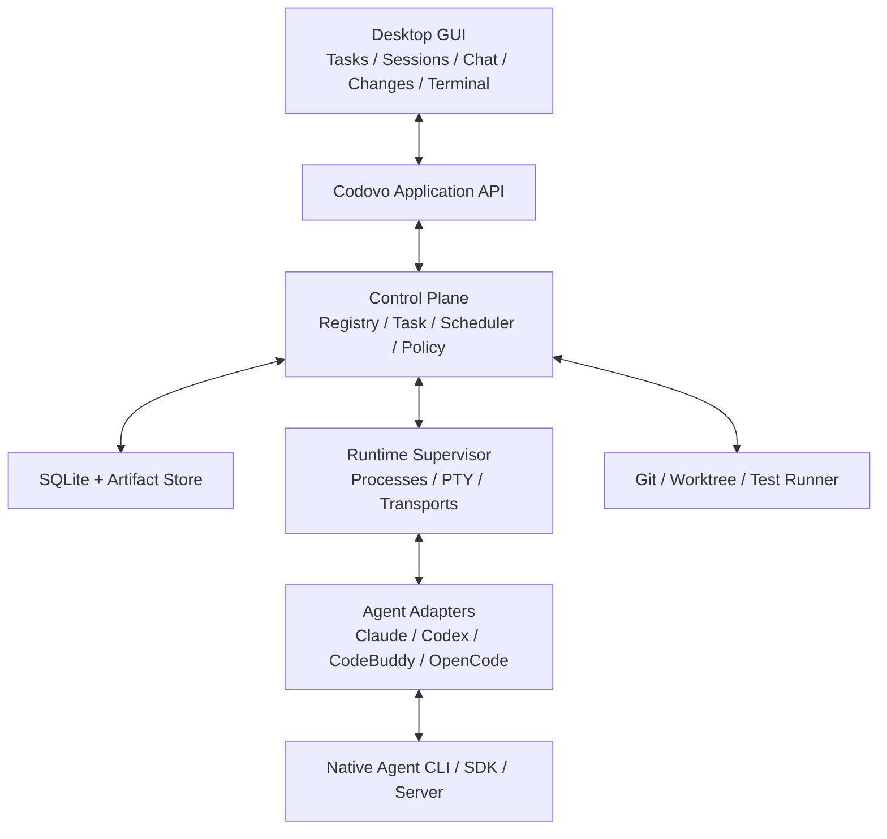
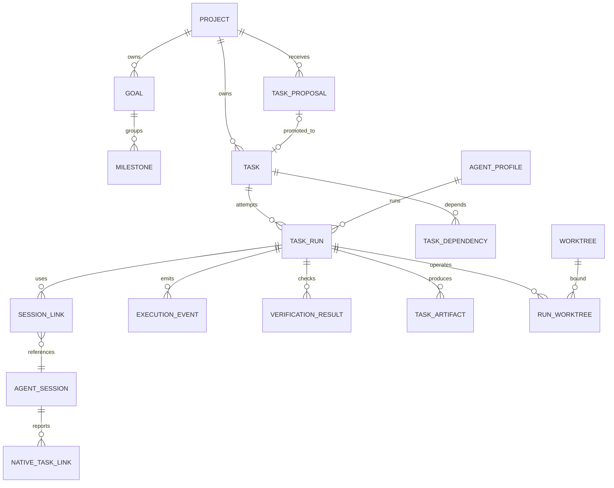
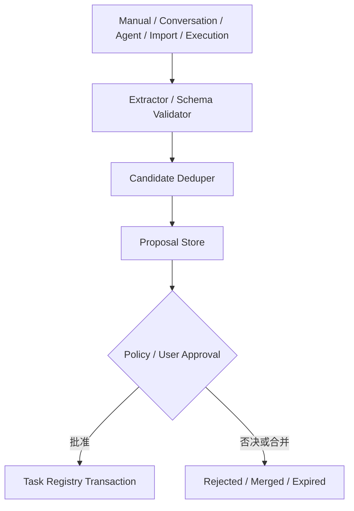

# Codovo 统一控制平台技术设计与接口契约

> 版本：v1.0 · 2026-10-24  
> 关联：[PRD](./Codovo-PRD-v1.0.md) · [开发任务包](./Codovo-Development-Plan-v1.0.md)  
> 定位：面向编码的**参考架构**。接入真实仓库后，先提交 ADR 确认技术选型与兼容性，再落代码。

## 1. 架构原则

1. **控制与执行分离**：Codovo 掌握 Task/Run/Workspace/Policy；原生 Agent 掌握内部推理和工具执行。
2. **Session 与 Task 分离**：任务跨执行尝试，Session 依原生实现；Run 是两者之间的可审计关联。
3. **能力驱动**：按每次连接协商能力；不存在的能力不可通过解析 TUI 字符假装支持。
4. **事件为事实依据**：规范化事件带来源、证据、去重键；推断与原生事件不等价。
5. **可恢复**：先持久化 Run 意图，再启动进程；启动/崩溃/重启可对账。
6. **非破坏性兼容**：复用 xterm.js，现有原生配置和用户工作树优先保留。
7. **安全边界真实可执行**：CLI 内部授权与 OS/沙箱边界分层，不承诺无法强制的限制。
8. **本地优先，接口可扩展**：初版单用户本地存储，Control Plane / Runtime 通过端口接口隔离，为未来远程执行留边界。

## 2. 目标部署与模块关系



若现有仓库已经定义合理的模块与进程边界，应通过 ADR 说明适配方案，不为迎合本文示例强行移动目录。

建议边界：

- `core-domain`：纯领域实体、状态机、错误类型、规则，不直接依赖 Tauri 或具体 CLI。
- `application`：use case、数据库事务、调度、权限策略、事件处理。
- `ports`：AgentAdapter、ExecutionRuntime、TaskRepository、WorkspaceService、Verifier 等接口。
- `adapters`：厂商 SDK/JSONL/HTTP/PTY 实现。
- `infrastructure`：SQLite、Git CLI、OS 进程管理、日志持久化、Secret Store。
- `desktop-api`：Tauri Command/Event 或现有本地 IPC，UI 不直接读写 SQLite。

## 3. 任务实体与关系



`Goal/Milestone` 可以通过外键与任务关联；允许尚未指定里程碑的独立 Task。一个 Run 可关联多个 Repo/Worktree，不应写死单目录。Session Link 应容纳主会话及原生子会话，主会话至多一个活动引用。

### 3.1 推荐核心字段

| 实体 | 必需字段（此外均有 id、created_at、updated_at） |
|---|---|
| `TaskProposal` | project_id, title, description, acceptance_json, origin_type, origin_ref, parent_task_id?, evidence_json, risk_level, status, dedupe_hint_json, proposed_by |
| `Task` | project_id, goal_id?, milestone_id?, parent_task_id?, title, description, acceptance_json, priority, status, assigned_profile_id?, current_run_id?, optimistic_version |
| `TaskDependency` | task_id, depends_on_task_id, type（finish_to_start）, created_at |
| `TaskRun` | task_id, attempt_no, profile_id, execution_context_json, status, started_at?, ended_at?, exit_code?, termination_reason?, handoff_artifact_id? |
| `AgentSession` | adapter_id, profile_id, native_session_id?, transport, recovery_strategy, status, last_seen_at, native_metadata_json |
| `SessionLink` | run_id, session_id, role（primary/child/related）, linked_at |
| `ExecutionEvent` | run_id?, session_id?, source, event_type, event_key, sequence_no?, observed_at, recorded_at, payload_json, schema_version |
| `VerificationResult` | run_id, check_name, command?, status, exit_code?, artifact_id?, verified_at |
| `TaskArtifact` | task_id, run_id?, type, path_or_uri, hash?, provenance, metadata_json |
| `Worktree` | repository_id, absolute_path, branch?, head_sha?, owned_by_codovo, lifecycle_status |
| `RunWorktree` | run_id, worktree_id, access_mode（read/write）, base_sha?, final_sha?, dirty_before, dirty_after |
| `NativeTaskLink` | session_id, native_task_id?, parent_task_id?, native_state, confidence, source_event_key, content_json |

额外建议 `SchemaMigration`、`AgentInstallation`、`AgentProfile`、`ProjectRepository`、`PermissionDecision`、`ProposalDecision`、`AuditLog`、`WorkspaceLease` 等表。SQLite 开启 FK、WAL 和 Migration；写事务与幂等键保证一致性。

### 3.2 重要唯一性与完整性约束

- `TaskRun`: `UNIQUE(task_id, attempt_no)`；尝试编号由数据库事务分配。
- `ExecutionEvent`: `UNIQUE(adapter_id, event_key)`（或在设计中选择以 `session_id` 加 `event_key` 作为唯一域）；无原生 ID 时生成稳定的传输窗口内去重键，不能简单以消息文本去重。
- `TaskDependency`: `UNIQUE(task_id, depends_on_task_id)`，禁止自依赖和环依赖。
- `Task`: `optimistic_version` 防止多个 UI/Agent 同时覆盖。
- `TaskProposal`: 提升操作幂等，`promoted_task_id` 可空；批准重复调用不能产生双 Task。
- `SessionLink`: 同一 Run 的 primary link 至多一个；跨 Run 复用原生 Session 须显式记录且不能同时送入相互冲突的指令。
- 对不明来源的 Worktree 只读记录，不自动删除；对存在未提交变更的工作树禁止静默清理。

## 4. 双层状态机

### 4.1 Proposal 状态

`detected -> pending_review -> approved | rejected | merged | expired`

自动策略批准也记录 `approved`，但 `decision_actor=policy`。批准事务内创建 Task（或引用已存在 Task）并写审计记录；任意网络/GUI 重试不重复创建。

### 4.2 Task 状态

`pending -> ready -> running -> reviewing -> completed`

扩展：`ready/running -> blocked`；`running/reviewing -> failed`；未完成状态可 `cancelled`；`blocked/failed/reviewing -> ready` 需带理由创建新 Run 或重新调度。`completed` 默认不可无审计直接改回；需求变更建议创建新 Task/Revision。

**不变量**：

- 未满足强依赖时不可进入 `ready/running`（人工覆盖需审批记录）。
- `run.succeeded` 不等于 `task.completed`；结束只会使任务进入 `reviewing` 或根据失败原因进入 `blocked/failed`。
- `task.completed` 必须存在验收记录；`verification` 可为人工豁免，但必须留下原因。
- 同一 Task 同一时刻默认只有一个活动 Run；并行候选方案通过不同 Task 或显式实验模式管理。

### 4.3 Run 状态

`queued -> starting -> running <-> waiting_input -> succeeded | failed | cancelled | interrupted`；另有 `cancelling` 和 `unknown`。

- 请求取消 `running/waiting_input -> cancelling`，经退出确认才 `cancelled`，不可先写终态。
- 进程退出、Turn 完成、Terminal 窗口关闭是不同事件。仅 Native CLI 结束且 Adapter 说明 Run 结束时才收敛 Run 终态。
- 重启后无法确认的活动进程为 `unknown`；通过进程所有权、原生 Session、心跳或人工选择核对后更新。

## 5. Agent Adapter 接口契约

> 以下 TypeScript 类型是跨端协议说明；Rust 可实现同语义的 trait。字段按需求增补，避免接口无控制地膨胀。

```ts
type IntegrationMode = 'pty' | 'headless' | 'native_api';

interface AgentCapabilities {
  mode: IntegrationMode;
  structuredEvents: boolean;
  streamText: boolean;
  persistentSession: boolean;
  sessionResume: boolean;
  sessionFork: boolean;
  interactiveTurn: boolean;
  nativeToolEvents: boolean;
  approvalCallback: boolean;
  nativeTaskEvents: boolean;
  tokenUsage: boolean;
  modelSelection: boolean;
  nativeSubagents: boolean;
}

interface AgentInstallation {
  adapterId: string;
  executablePath?: string;
  version?: string;
  auth: 'ready' | 'needs_login' | 'unknown';
  supportedModes: IntegrationMode[];
  diagnostics: string[];
}

interface AgentAdapter {
  detect(): Promise<AgentInstallation>;
  capabilities(profileId: string): Promise<AgentCapabilities>;
  launch(request: LaunchRequest): Promise<NativeHandle>;
  send(handle: NativeHandle, input: AgentInput): Promise<void>;
  cancel(handle: NativeHandle): Promise<ControlResult>;
  stop(handle: NativeHandle): Promise<ControlResult>;
  resume?(request: ResumeRequest): Promise<NativeHandle>;
  respondToApproval?(handle: NativeHandle, decision: ApprovalDecision): Promise<void>;
  subscribe(handle: NativeHandle, onEvent: (event: AgentEvent) => void): Unsubscribe;
  reconcile?(handle: NativeHandle): Promise<NativeStatus>;
}
```

`NativeHandle` 不应暴露为单纯 PID：可能是本地 PID、HTTP session ID、JSON-RPC Thread ID 或几者的组合。所有 Handle 都要有 `adapter_instance_id` 和连接状态。`stop` 是尝试结束执行，不等于“强杀所有子进程”；必须返回操作结果。

### 5.1 三类接入方式

| 方式 | 读写通道 | 可靠观察范围 | 明确限制 |
|---|---|---|---|
| L1 PTY/TUI | 终端字节流/键盘输入 | 启动/退出、终端显示、有限外部 Git/FS 观察 | 不承诺原生工具事件、精确 Token、真正审批回调 |
| L2 Headless/JSONL | stdin/stdout JSON Lines/一次或持续执行 | 明确提供的消息、工具和结果事件 | 常有交互/审批/恢复差异 |
| L3 SDK/App Server/API | 厂商协议 | 会话、Turn、工具、授权（按厂商能力） | 协议可能变更或版本差异 |

兼容级别是 Codovo 定义，不是厂商官方评级。优先选经测试最稳定的模式；CLI 版本升级后重新探测能力。原生 terminal 与结构化客户端并非总能安全热切换，须 Adapter 声明是否支持附着。

### 5.2 厂商适配策略（首选，不保证所有版本）

- **Codex**：优先 App Server 的 Thread/Turn、事件、授权交互；回退 `codex exec --json`；最后 PTY。
- **OpenCode**：优先 `serve`/Server API + SDK，维护 Session ID；回退 CLI/PTY。
- **Claude Code**：优先 Agent SDK 或 Headless `stream-json`；利用官方能力做会话关联、工具事件和审批；回退 PTY。
- **CodeBuddy**：优先 Agent SDK/Headless JSON；安全审批能力须按版本测；回退 PTY。禁止仅为不交互模式默认打开 `dangerously-skip-permissions`。

官方参考：

- Codex App Server：https://learn.chatgpt.com/docs/app-server
- Codex 非交互 JSON：https://learn.chatgpt.com/docs/non-interactive-mode
- Claude Code Headless：https://code.claude.com/docs/en/headless
- OpenCode Server：https://docs.opencode.ai/docs/server/
- OpenCode SDK：https://docs.opencode.ai/docs/sdk/
- CodeBuddy SDK：https://intl.cloud.tencent.com/ind/document/product/1316/84476
- CodeBuddy Headless：https://www.tencentcloud.com/document/product/1316/84420

## 6. 事件协议

### 6.1 标准 Envelope

```json
{
  "schemaVersion": 1,
  "eventId": "evt_01...",
  "eventKey": "codex:thread-123:seq-42",
  "type": "tool.started",
  "source": "native",
  "adapterId": "codex",
  "profileId": "codex-default",
  "sessionId": "cs_01...",
  "nativeSessionId": "thread-123",
  "runId": "run_01...",
  "sequence": 42,
  "occurredAt": "2026-10-24T09:00:00Z",
  "recordedAt": "2026-10-24T09:00:00.100Z",
  "payload": { "toolName": "shell", "callId": "call-9" }
}
```

示例 ID 仅展示形状。事件类型建议：

- Agent：`agent.started`, `agent.exited`, `agent.health_changed`
- Session：`session.started`, `session.resumed`, `session.detached`, `session.ended`
- Turn：`turn.started`, `message.delta`, `message.completed`, `turn.completed`
- Tool：`tool.started`, `tool.output`, `tool.completed`, `tool.failed`
- Approval：`approval.requested`, `approval.decided`
- Runtime：`run.queued`, `run.started`, `run.status_changed`, `run.ended`
- Files/Git：`file.changed`, `git.snapshot_created`（外部观察）
- Task：`task.proposal_created`, `task.state_changed`, `task.verification_recorded`

`source` 枚举 `native | observed | inferred | user | policy`。前端必须在可靠性受限的关键事件上展示来源；避免从 `file.changed` 推断“哪个 Agent 必然修改”。适配器保留 raw payload 供诊断，但需脱敏；规范化 payload 有受版本控制的 schema。

### 6.2 事件送达语义

- 采用“至少一次投递 + 幂等落库”，不宣称 exactly-once。
- 同一 Session 内已知序号保序；跨 Session 全局不承诺完全顺序，统一 UI 可按时间线排序并显示时钟偏差。
- 高频 `message.delta` 可以批量缓冲/压缩，但 `approval`、状态变化和终结事件优先可靠记录。
- 背压时限定队列上限，不能让无界终端输出吃尽内存；诊断日志保留截断标记。
- 存在敏感信息的字段在日志与 UI 消费时脱敏；用户可按策略禁用正文长期存储。

## 7. Task Proposal Pipeline



### 7.1 推荐 Proposal JSON 契约

```json
{
  "title": "实现索引增量更新 API",
  "description": "为搜索服务提供增量更新调用接口",
  "parentTaskId": "task-128",
  "acceptanceCriteria": [
    "新增 API 有自动化测试",
    "增量文件变更可被查询到"
  ],
  "dependencies": [],
  "source": {
    "kind": "agent",
    "profileId": "claude-default",
    "sessionId": "cs-52",
    "nativeTaskId": null,
    "evidenceEventIds": ["evt-88"]
  },
  "proposedRisk": "medium",
  "reason": "当前搜索任务发现阻塞依赖"
}
```

输入校验：标题非空、描述与验收标准长度限制、依赖 ID 存在、项目权限允许、不得跨项目隐式创建、最大层级/分解数量限制。避免将 Agent 输出 JSON 直接作为数据库 SQL 或系统命令执行。

### 7.2 对话识别策略

MVP 首先提供显式“转换为 Task/提案”入口；自动识别放在 Beta。自动判别返回 `not_a_task | proposal | needs_clarification`，只创建 Proposal，不隐式启动执行。引用原始对话事件和发生时的工作上下文。无法结构化读取的 PTY 会话仅能基于用户选中的文本/明示摘要创建 Proposal。

### 7.3 去重与批准

先按 project/goal/parent、状态和关联文件等做候选过滤；再做规则/语义相似度提示；不基于标题相近自动合并。批准使用单数据库事务：锁定 Proposal → 查验证据与依赖 → 创建 Task 与依赖 → 更新 Proposal 的 promoted_task_id → 写审计。失败整体回滚。

## 8. Task Run 调度与 Handoff

### 8.1 调度决策

准入条件：Task Ready、依赖满足、配置 Profile 可用、所需能力满足、Workspace 可访问、未超过并行上限和时间预算、权限策略允许。调度生成不可变的 `ExecutionContextSnapshot`，包含 CLI 版本、Profile ID、模型（若可读）、工作目录/仓库、Worktree、权限和资源绑定快照。

### 8.2 执行过程

1. 事务中创建 `queued` Run 并获得 attempt_no；
2. 获取工作区写锁/租约，捕获 Git baseline 与 dirty 状态；
3. 持久化 launch intent；
4. Runtime 调用 Adapter 启动并记录 Handle/SessionLink；
5. 订阅事件、持久化状态；
6. Turn/进程结束后捕获 Git final state 并运行验证；
7. 写 Run 终态、生成 Handoff/Artifact、释放租约；
8. Task 进入 Reviewing/Blocked/Failed，待验收后 Completed。

发生半启动故障时，依据 launch intent 和可核实的 PID/native ID 进行对账。不要在不知是否已启动时盲目再次创建同一 Run 的进程。

### 8.3 Handoff 数据契约

```json
{
  "schemaVersion": 1,
  "taskId": "task-128",
  "fromRunId": "run-17",
  "summary": "初步完成搜索 API，测试仍失败",
  "completedClaims": ["搜索路由实现"],
  "remainingWork": ["修复两个集成测试"],
  "decisions": ["保留异步搜索接口"],
  "git": [{
    "repositoryId": "repo-1",
    "baseSha": "abc123",
    "headSha": "def456",
    "dirty": true,
    "changedPaths": ["src/search.rs"]
  }],
  "verifications": [{ "name": "cargo test", "status": "failed", "exitCode": 101 }],
  "evidence": [{ "kind": "verified_by_check", "ref": "check-22" }],
  "risks": ["工作树存在未提交修改"],
  "nextSuggestedAction": "检查失败测试并修复"
}
```

交接前先读取真实工作树和测试结果，LLM 生成摘要仅作为 `reported_by_agent`，不能覆盖 Git/测试事实。跨 Agent 任务接续默认**新建原生 Session 和 Run**。

## 9. Workspace / Git 约束

- Worktree 路径应由平台在已批准的项目工作区内生成，不接受由模型提供的任意删除路径。
- 分配写任务前优先创建独立 Worktree；共享写入需显式授权并降低归属准确度。
- 不因为任务终止自动删除有 dirty 状态的 Worktree；没有平台所有权的工作树绝不自动删除。
- 对多仓库任务建立 `RunWorktree[]`，各仓库分别读取 base/head SHA，记录是否有未提交文件。
- 通过 Git 获取 diff 事实，文件系统 Watcher 只用于提示变化。Watcher 事件不等价于真实提交记录。
- Review 与 Merge 是独立工作流，不默认 Agent 能直接推送远程或修改主分支。

## 10. 权限与凭据

**外层**：进程/文件系统/网络/可执行程序/时间边界，取决于操作系统与沙箱可用性。**内层**：原生 Agent 的工具授权、Hooks、SDK permission callback。两层能力在 UI 分别展示；不能保证的限制显示“不受控”。

敏感内容包括 API Keys、OAuth Tokens、Git 凭据和私有仓库内容。认证复用厂商既有安全方式或 OS Credential Store，不写 SQLite 明文。诊断与事件正文脱敏；不默认向云服务发送任务日志。

## 11. 资源目录与配置解析

`ResourceRegistry` 保存 MCP、Skills、Rules、Hooks、Profiles 的逻辑定义、来源、版本、作用域、兼容性；`ConfigResolver` 按 global/project/workspace/profile 合并，生成厂商特定配置的**预览**。写入原生文件仅在用户确认且备份/冲突检查通过时发生。初期以非侵入式 CLI 参数、受控配置目录优先。

## 12. UI—Core API（示例）

以下为稳定的 Use Case 意图；实际 Tauri IPC 命名可映射，避免界面直接操作进程：

```text
agents.detect
agents.list_profiles
agents.get_capabilities(profile_id)
sessions.start(profile_id, workspace_id, mode)
sessions.send(session_id, input)
sessions.cancel(session_id)
sessions.stop(session_id)
sessions.get_status(session_id)
proposals.create(payload)
proposals.list(filters)
proposals.decide(id, action, patch, expected_version)
tasks.create(payload)
tasks.list(filters)
tasks.update(id, patch, expected_version)
tasks.get(id)
tasks.add_dependency(id, depends_on_id)
runs.start(task_id, profile_id, workspace_binding)
runs.cancel(run_id)
runs.get(run_id)
runs.list_events(run_id, cursor)
verification.record(run_id, result)
acceptance.decide(task_id, decision, evidence_ids)
workspace.list_repositories(project_id)
workspace.list_worktrees(repository_id)
workspace.create_worktree(request)
git.get_diff(run_id, repository_id)
```

所有突变 API 必须校验权限、实体版本与路径范围；删除或强制覆盖等操作不得通过通用 `update` 绕过审计。事件订阅按 `session_id/run_id` 可重放游标。HTTP/IPC 错误规范包含 `code`、`message`、`retryable`、`details`、`traceId`。

## 13. 数据迁移与兼容策略

1. 优先探查现有终端管理器与本地数据库；先把原有 PTY Session 包装到 Runtime Port，不重写终端控件。
2. 增量 Migration 建立核心表；不扫描并导入全部厂商隐藏会话数据。
3. 如果已有 Session 记录，则通过迁移映射其 identity 并保留旧行为；不伪造 Native Session ID。
4. 新功能使用 Feature Flag：`unified_session`、`structured_agent`、`task_registry`、`managed_execution`、`auto_proposal`、`orchestration`。
5. 错误恢复优先无损回退到原有 PTY 功能；保留数据升级备份与版本标记。

## 14. 测试架构

| 类别 | 必备测试 |
|---|---|
| 单元 | Task/Proposal/Run 状态转换、依赖环检测、配置解析、事件规范化、去重 |
| 契约 | Fake Adapter 按规范模拟消息、失败、取消、无能力、恢复、审批 |
| 集成 | SQLite Migration、事务幂等、PTY 生命周期、Git Worktree 快照与锁 |
| 兼容 | Claude/Codex/CodeBuddy/OpenCode 已知版本的能力探测与 JSON Schema golden fixtures |
| 端到端 | PRD E2E-01 至 E2E-12；窗口关闭/应用重启/CLI 崩溃/进程遗留 |
| 安全 | 非授权目录访问、危险命令审批、凭据泄漏、路径穿越、恶意终端转义序列 |

测试不应依赖真实付费模型完成所有 CI：使用 Fake Agent Adapter 与录制的脱敏事件 Fixtures，真实 CLI 烟测作为可选/人工流水线。

## 15. 架构 ADR 待确认

| ADR | 决策问题 | 建议默认 |
|---|---|---|
| ADR-001 | 后端与 GUI 框架 | 沿用现有；若已用 Tauri/Rust + TS，保持一致 |
| ADR-002 | 事件存储 | SQLite + 分段 raw log |
| ADR-003 | Adapter 边界 | Rust 端口 + 厂商协议实现；必要时 Sidecar |
| ADR-004 | Agent Session 复用 | 默认 Run 创建新主会话；复用须经过 Adapter 能力验证 |
| ADR-005 | Task 默认验收 | 人工确认；低风险自动验收后置 |
| ADR-006 | PTY 兼容 | 绝不为统一聊天牺牲原生 TUI 能力 |
| ADR-007 | 任务事件保留 | 关键状态长期保留，消息正文依隐私设置存储 |
| ADR-008 | 多工作树策略 | 并行写任务默认独立 Worktree，现有用户 Worktree 不自动清理 |

## 16. 首版验收清单

- [ ] 四家 Agent 至少可通过保底 PTY 检测、启动与显示终端，平台功能开关正确。
- [ ] Task/Run/Session 具有独立身份、持久化与状态机测试。
- [ ] Proposal 审批事务幂等；依赖不可形成循环。
- [ ] Git/工作区关联不会误删用户数据；存在 dirty Worktree 时停止自动清理。
- [ ] Run 失败、终端关闭、Turn 结束都不能直接将 Task 标记完成。
- [ ] 至少有一个带结构化事件的 Adapter 真实烟测，其余有 Fake 契约测试。
- [ ] Event Store 支持重新打开 Run 时间线；包含来源、错误和可用证据。
- [ ] 旧终端功能可以完全回退，既有用户设置未被覆盖。
