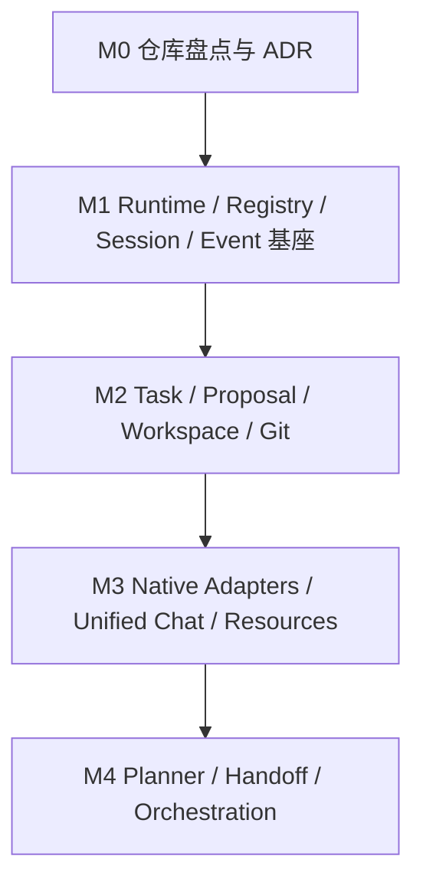

# Codovo 多 Coding Agent 统一管理平台 — 开发计划与 Coding Agent 任务包

> 版本：v1.0 · 2026-10-24  
> 输入：[PRD](./Codovo-PRD-v1.0.md)、[技术设计](./Codovo-Architecture-v1.0.md)  
> 用途：可复制进 Codovo、Claude Code、Codex、CodeBuddy、OpenCode 的工程任务清单与执行协议。

## 0. 开发前提

本计划是**增量改造已有 Codovo**，不是创建同名空白项目。当前未提供 Codovo 代码仓库，目录/脚本/框架不能视为已知事实。第一个 Coding Agent 必须完成仓库盘点和技术 ADR，之后才能实施 P1/P2 任务。

预算预估：P0 约 3—5 天、P1 约 2—3 周、P2 约 3—4 周、P3 约 3—4 周、P4 约 4—6 周，受团队并行度与原生接口兼容性影响显著，**不得直接按此预测发布日期**。

## 1. 执行方式与任务标识

任务采用稳定 ID：`CODO-000` 起。一个任务通常 0.5—2 人日，超出应提出拆分 Proposal。每个任务应有：

1. 范围：明确本任务修改/不修改什么；
2. 依赖：必须已合入或准备好的上游契约；
3. 实现：产出代码、Migration、Fixture、文档之一；
4. 验收：至少一个可验证测试或可复现流程；
5. 交接：变更文件、运行命令、结果、风险与剩余问题。

任务状态建议：`pending / ready / running / reviewing / completed / blocked / failed / cancelled`。这是计划记录，不等于 Codovo 新功能已经实现。

### 1.1 Git 与变更纪律

- 完成 P0 仓库分析以前，不自行变更项目技术栈、目录大结构或依赖管理器。
- 一个 Task 对应一条特性分支；并行写任务优先独立 Git Worktree；不在用户未提交的主工作树上执行破坏性操作。
- Agent 只修改当前任务必需的文件。已有未提交修改视为用户资产，不清理、不重置、不覆盖。
- 约束公共契约先实现/审查，再开展平行模块；数据库 Migration、API、领域类型修改应由明确任务所有者完成。
- 禁止未经授权自动 push、强制重写历史、删除有未提交修改的 Worktree、修改系统凭据。
- 每个 Task 在实现前执行只读检查；提交前运行相关格式化、静态检查、测试并保存输出摘要。

## 2. 总体里程碑与依赖



P2 完成基础 API 后，P3 中不同厂商 Adapter 可并行开发；P4 的 Handoff 与自动验证可以在 P3 Adapter 逐步稳定时开发，但正式上线必须符合退出门槛。

| 里程碑 | 关键交付 | 退出门槛 |
|---|---|---|
| M0 | 现状分析、接口清单、ADR、实施计划修订 | 识别现有终端/DB/Git 入口；所有未知技术假设已标注 |
| M1 | 统一 Registry、Runtime、Session、Event | 旧 PTY 不回退；Fake Adapter 生命周期/故障测试通过 |
| M2 | Proposal、Task、Run、Worktree、变更关联 | E2E-02、03（显式提案版）、05、06、07 可复现 |
| M3 | 结构化 Agent 集成、统一聊天、设置管理 | 至少两种 Agent 深度集成可用；四家有保底和能力说明 |
| M4 | 长程任务、交接、依赖调度、自动验证 | 任务跨 Agent 恢复；有限重试、权限与超时可验证 |

## 3. 完整任务列表

以下任务按基础依赖排序。`P0` 表示技术预研阶段，不等同产品功能优先级。

### M0：现有代码盘点与架构决策

| ID | 任务 | 前置 | 交付与验收 |
|---|---|---|---|
| CODO-000 | 仓库结构与技术栈盘点 | 无 | 形成 `docs/codovo-current-state.md`，列出现有 GUI、后端、终端、Git、DB、测试命令 |
| CODO-001 | 现有 PTY/Session 流程追踪 | 000 | 启动、resize、stdin/stdout、退出、停止的调用链与回归用例 |
| CODO-002 | CLI 能力探测实验 | 000 | 四家 Agent CLI 路径、版本、认证、可用 API/JSON 模式、权限行为记录表 |
| CODO-003 | 形成 ADR 与实现切入点 | 000—002 | 通过 8 项 ADR；列出需要新增/复用/淘汰的模块；批准后的修订任务排序 |
| CODO-004 | 建立 CI/测试/Fixture 基线 | 000,003 | 可运行的最小单测、集成测试、Fake CLI/Adapter Fixture，记录既有测试基线 |

### M1：统一运行基础设施

| ID | 任务 | 前置 | 交付与验收 |
|---|---|---|---|
| CODO-101 | 定义领域 ID、错误类型和能力协议 | 003 | `AgentCapabilities`、`NativeHandle`、基础类型；序列化与兼容测试 |
| CODO-102 | Agent Registry 与安装检测 | 101 | 扫描/注册/版本/认证状态；缺失 CLI 不崩溃 |
| CODO-103 | Agent Profile 与安全配置 | 101,102 | Profile CRUD、环境变量注入、凭据排除；不写明文 Token |
| CODO-104 | Runtime Process Supervisor | 001,101 | 进程创建/停止/取消/异常退出/超时，具备资源释放测试 |
| CODO-105 | PTY Adapter 包装原终端 | 001,104 | xterm.js 全功能回归；原始 TUI 路径不回退 |
| CODO-106 | AgentAdapter 抽象 + Fake Adapter | 101,104 | 契约测试覆盖启动、发送、取消、失联、异常、能力缺失 |
| CODO-107 | SQLite Schema / Migration v1 | 003,101 | Registry、Session、Event 核心表；升级/兼容/事务测试 |
| CODO-108 | Session Manager 与 Native ID 映射 | 105—107 | Session 启动/列表/关闭/关联；未知恢复能力不强行 Resume |
| CODO-109 | Event Envelope / Bus / Store | 106—108 | 结构化事件归一、幂等去重、分页查询、背压测试 |
| CODO-110 | App 重启与进程状态对账 | 104,108,109 | 进程消失或失联可标 `unknown/interrupted`；不虚构成功 |
| CODO-111 | Agent/Session 管理 GUI | 102,103,108,109 | Agent 状态、能力、Session 列表、PTY 回退可见 |
| CODO-112 | M1 回归与示例演示 | 105,110,111 | 4 种 PTY/模拟运行路径；崩溃、取消、异常与重启验收 |

### M2：任务管理与工作区

| ID | 任务 | 前置 | 交付与验收 |
|---|---|---|---|
| CODO-201 | Goal/Milestone/Task 领域模型与 Migration | 107,112 | 状态机、乐观锁、CRUD；非法状态转换被拒绝 |
| CODO-202 | Task Proposal/Decision 实体和存储 | 201 | 候选、来源证据、审批/拒绝/合并状态，审批幂等 |
| CODO-203 | 依赖 DAG 与父子任务模型 | 201 | 环检测、跨项目校验、阻塞/Ready 计算单测 |
| CODO-204 | Task Run 生命周期与事务 | 201,108 | `attempt_no`、Run 状态、SessionLink、失败重试 |
| CODO-205 | 手工 Task/Proposal API 与界面 | 202—204 | 建任务、批准 Proposal、Run 历史和基础看板 |
| CODO-206 | Project / 多 Repo / Workspace 模型 | 201 | 关联多仓库、权限范围、仓库有效性校验 |
| CODO-207 | Git Worktree 管理与租约 | 206 | 创建/列表/锁；不删除非平台所有或 dirty Worktree |
| CODO-208 | Run 与 Git baseline/final 快照 | 204,207 | 记录 SHA、dirty、changedPaths、diff 证据 |
| CODO-209 | 手动托管执行 Task → Run → Adapter | 204,106,207 | 从任务启动指定 Agent，停止后任务仍可验收/重试 |
| CODO-210 | Verification / Acceptance 记录 | 204,208 | Agent 声明、测试结果、人工验收独立入库 |
| CODO-211 | 原生终端“转换成任务”入口 | 202,108,205 | 创建 Proposal 并绑定 Session；缺失信息明确标未知 |
| CODO-212 | Tasks / Changes 详情 GUI | 205,208,210 | Task→Run→Events→Diff→Verification 可导航 |
| CODO-213 | M2 E2E 验收 | 207—212 | 任务跨 Run、恢复、Worktree 隔离、结果验收通过 |

### M3：深度接入与统一交互

| ID | 任务 | 前置 | 交付与验收 |
|---|---|---|---|
| CODO-301 | 定义结构化消息/工具/审批 UI 契约 | 109,212 | 消息流、Tool Card、来源可信度、审批状态模型 |
| CODO-302 | Codex App Server Adapter | 106,301 | Thread/Turn/事件/取消；权限按探测能力；黄金 Fixture |
| CODO-303 | OpenCode Server/SDK Adapter | 106,301 | Session/消息/状态/取消；重连与 HTTP 失败测试 |
| CODO-304 | Claude SDK/Headless Adapter | 106,301 | JSON 事件/结果、原生 Session 关联、流式消息测试 |
| CODO-305 | CodeBuddy SDK/Headless Adapter | 106,301 | JSON 事件/结果；授权策略无危险默认绕过 |
| CODO-306 | 统一聊天视图与终端共存 | 301—305 | 能力明确；不能安全热切换时保留独立 UI 模式 |
| CODO-307 | Conversation→Task Proposal 显式转换 | 202,306 | 选消息转候选、来源引用可追溯、非任务不会自动创建 |
| CODO-308 | Agent Permission Bridge 与外层策略 | 301—305 | 原生支持才提供审批回调，拒绝/超时可处理 |
| CODO-309 | MCP/Skills/Rules Resource Registry | 103,306 | 资源索引、作用域、冲突预览，不静默覆盖配置 |
| CODO-310 | 诊断导出与版本兼容测试矩阵 | 302—309 | 脱敏日志包、每家 Adapter 支持能力与降级记录 |
| CODO-311 | M3 E2E 验收 | 306—310 | 结构化消息、取消、出错、原生终端保底与审批一致性 |

### M4：长程任务与多 Agent 编排

| ID | 任务 | 前置 | 交付与验收 |
|---|---|---|---|
| CODO-401 | Proposal Pipeline 与 Schema 校验 | 202,307 | 人工/对话/Agent/导入/执行 5 种来源统一入口 |
| CODO-402 | Planner Agent 结构化任务分解 | 401,203 | Goal→Proposal 列表、DAG 校验、预览编辑确认 |
| CODO-403 | 候选去重与创建策略 | 401 | Manual/Assisted/Autonomous Limited；去重建议不误合并 |
| CODO-404 | Native Task 发现与关联 | 302—305,401 | 原生 Todo/Plan 能力支持则映射，无法观察时标未知 |
| CODO-405 | Handoff Package 与证据分级 | 204,208,210 | 结构化交接包；Agent 声明 vs Git/检查事实可区分 |
| CODO-406 | 任务接管与跨 Agent 新 Run | 405,306 | 一 Task 多 Run；跨 Agent 不伪装迁移原生上下文 |
| CODO-407 | 依赖队列调度与资源预算 | 203,209,403 | 最大并发、超时、重试次数、工作树租约强制检查 |
| CODO-408 | Verifier 工作流与派生修复 Proposal | 210,401,407 | 自动检查产出验证记录，失败可提议修复但不无限循环 |
| CODO-409 | Planner→Developer→Reviewer 工作流 | 402,405—408 | 按依赖流转、可人工接管和有限重试 |
| CODO-410 | 长程任务工作台与监控 | 405—409 | Goal 进度、任务依赖、Agent Run、成本/用时（若数据可信） |
| CODO-411 | M4 E2E、故障注入与稳定性 | 406—410 | 崩溃、双写、重复提交、重试上限、恢复与验收流程测试 |

## 4. 最优先实施的前 12 项任务卡

这些任务定义到可以直接发给 Coding Agent 的粒度。其它任务依照同一模板执行，不要在未完成先修项时抢跑。

### CODO-000：仓库盘点

**输入**：Codovo 仓库、PRD、技术设计。**只读**。

- 定位 GUI 入口、状态管理、原生终端组件、PTY 进程层、Git 组件、配置存储和数据库。
- 检查 package manager、Rust workspace、Tauri 版本（如果存在）、测试和打包脚本。
- 绘制现状模块图，并标注未知与风险；不擅自安装全局依赖。
- **交付**：`docs/codovo-current-state.md`；现状模块列表、关键源码位置、已有能力/缺口表、建议实施顺序。
- **验收**：所有结论引用真实文件路径/命令；没有改动业务代码。

### CODO-001：PTY 调用链与回归基线

- 输入：CODO-000。
- 追踪终端新建、输入、resize、停止、应用退出、子进程处理。
- 生成可重复运行的最小 smoke scenario；不使用真实模型消费作为必要条件。
- **交付**：调用链说明和测试；列出新 Runtime 接入时必须保留的行为。
- **验收**：已知 PTY 输入/输出/resize/退出场景能重复执行。

### CODO-002：Agent 适配探索

- 输入：CODO-000；允许执行无破坏性的 `--version`/`--help` 与官方文档验证。
- 对 Claude/Codex/OpenCode/CodeBuddy 记录支持的启动、Headless、SDK/Server、JSON 流、恢复、取消、审批、Session ID 能力。
- **交付**：`docs/agent-compatibility-matrix.md`，每项标注 `verified / documented / unknown / unsupported`、版本与测试证据。
- **验收**：不使用危险免审批选项完成主机上的写入烟测。

### CODO-003：ADR 与接口切入点

- 对照现状，决定核心接口和模块边界、数据存储、Sidecar 策略、原有 Session 兼容、配置读写策略。
- **交付**：ADR-001~008；需调整的 PRD/任务说明；明确保留旧终端的回滚 Feature Flag。
- **验收**：每个 ADR 至少记录备选方案、取舍与后果。

### CODO-004：测试基线

- 建立 Fake Agent 测试夹具，可模拟启动、流式输出、权限请求、取消、异常退出、重复事件。
- **交付**：测试夹具、快速执行命令、CI 任务和说明。
- **验收**：离线环境无需真实模型权限即可运行核心测试。

### CODO-101：能力协议与错误类型

- 实现 `AgentCapabilities` 和与厂商无关的错误类型：Unavailable、UnsupportedCapability、AuthRequired、Timeout、Conflict、PermissionDenied、TransportError。
- **交付**：接口/types + schema 序列化测试。
- **验收**：版本字段兼容；未知能力不会默认为 true。

### CODO-102：CLI Registry

- 实现路径解析、安装检测、版本获取、存在与不存在情况的状态反馈。
- **交付**：Registry Core/API/单测。
- **验收**：4 个模拟 CLI 可注册；缺失、命令返回异常、超时不造成 GUI 卡死。

### CODO-103：Agent Profile

- 支持默认工作目录、允许的环境变量映射、启动参数和用户可命名 Profile。
- **交付**：Profile CRUD、持久化、安全配置单测。
- **验收**：不会把 OS 环境中的 Secret 值复制到普通数据库/调试日志。

### CODO-104：Process Supervisor

- 复用现有 PTY 底座，抽象进程生命周期和取消/终止 API。
- **交付**：Process Handle/状态与超时测试。
- **验收**：可以区分 UI 窗口关闭与真正的进程退出；取消不会被直接当作成功。

### CODO-105：PTY Adapter

- 实现 L1 Adapter，以现有终端通道承载；保留终端模式、尺寸、复制粘贴行为。
- **交付**：PTY Adapter + GUI 回归证明。
- **验收**：在原有用例中不破坏 xterm.js；不伪造工具调用事件。

### CODO-106：Fake Adapter 契约

- 统一 LaunchRequest、NativeHandle、AgentEvent、stop/cancel/subscribe 行为。
- **交付**：Fake Adapter + 契约测试套件，为四家 Adapter 复用。
- **验收**：失败/取消/重连/无恢复能力/重复事件都具有固定预期。

### CODO-107：数据库初始迁移

- 先实现 Registry/Session/Event 必要表，后续 Task 表由 CODO-201/202 扩充。
- **交付**：Migration、索引、FK、幂等事务测试、迁移文档。
- **验收**：空库升级可重复；旧库升级前可备份；不破坏原有会话数据。

## 5. 可并行与不宜并行的任务

| 阶段 | 适合并行 | 需串行/协调 |
|---|---|---|
| M0 | 001 PTY 调用链、002 厂商能力研究 | 003 ADR 最终审定依赖全部报告 |
| M1 | 102 Registry、104 Supervisor、107 DB（契约确认后） | 101 公共接口先合并；108/109 等待依赖 |
| M2 | 206 Workspace 与 201 Task Schema（分域） | 204 Run、209 托管执行依赖两个域稳定 |
| M3 | 302/303/304/305 四个 Adapter 使用隔离 Worktree | 301 事件/消息协议先冻结；306 合并 UI 依赖 Adapter 验证 |
| M4 | 402 Planner 与 405 Handoff 可按契约并行 | 407 调度依赖 Task/Workspace/Policy，409 依赖其它工作流 |

多个 Agent 并行编码时，**不能同时编辑同一个 Migration、公共 TypeScript 类型文件或 Rust trait 文件**；指定契约 owner，其余通过接口实现。

## 6. Agent 执行协议（每个任务必须遵循）

建议在仓库内创建 `docs/codovo-agent-task-protocol.md`，内容以本节为起点，并由项目维护者确认后引用。

### 6.1 开始阶段

1. 阅读 PRD 中关联 FR、技术设计及当前任务描述。
2. 只读检查仓库与 `git status`，确认用户已有修改；列出本任务预计变更文件。
3. 核实上游任务是否已完成、所需接口是否存在，若缺失则标为 `blocked` 并提出最小澄清。
4. 明确设计与验收步骤，再开始改代码。

### 6.2 实现阶段

1. 保持最小变更范围，不私自重构无关模块。
2. 优先建立可测接口/领域规则，再写 UI 和厂商具体适配。
3. 增加成功、失败、取消、重试、兼容性降级测试。
4. 触及公共契约或数据库时更新文档和 Migration；不可直接改生产数据。
5. 危险操作（删除目录、强制推送、绕过权限、修改凭据）暂停并请求确认。

### 6.3 完成阶段

必须输出以下结构化摘要：

```yaml
task_id: CODO-101
result: completed   # completed / partial / blocked / failed
summary: 完成 AgentCapabilities 协议
changed_files:
  - path/to/file
tests:
  - command: cargo test -p codovo-core
    result: passed
decisions:
  - 缺失能力默认 false
risks: []
next_tasks:
  - CODO-102
```

示例测试命令需以真实仓库为准，不得未经执行声称通过。

## 7. 可复制的 Coding Agent 启动提示词

### 7.1 初次进入仓库：架构盘点 Agent

```text
你正在维护现有 Codovo 项目。先阅读：
1. Codovo-PRD-v1.0.md
2. Codovo-Architecture-v1.0.md
3. Codovo-Development-Plan-v1.0.md

本轮仅执行 CODO-000：现有代码盘点。不要直接实施新架构，也不要修改业务源码。
请检查实际项目目录、运行架构、Agent CLI/PTY/Session/Git/DB 实现及测试基线。
输出 docs/codovo-current-state.md，包含模块调用链、现有功能与 PRD 缺口、关键源码路径、
需确认的架构假设和建议下一任务。
你不能根据方案中的参考结构臆造仓库文件；所有技术事实必须以现有代码为依据。
```

### 7.2 执行单项任务：开发 Agent

```text
你是 Codovo 项目的 Coding Agent，本轮仅实现任务 {TASK_ID}：{TASK_TITLE}。

先阅读 PRD 中关联 FR/E2E、Architecture 的接口契约，以及 Development Plan 中该任务与前置依赖。
工作区：{WORKTREE_PATH}；分支：{BRANCH_NAME}。

要求：
1. 执行只读仓库检查，识别未提交用户修改及依赖是否就绪。
2. 先提出最小实现方案与涉及文件，不扩大范围。
3. 编写或修改代码和相应测试，保持既有功能兼容。
4. 对失败、取消、超时、重复事件、权限边界做必要测试。
5. 运行实际仓库定义的格式化/静态检查/测试，准确报告输出。
6. 不进行未授权的 destructive Git、文件系统或远程操作。
7. 最后按本计划 §6.3 的 YAML 格式输出交付与交接记录。

完成标准：任务验收全部满足；不能验证则标记 partial/blocked，不能声称完成。
```

### 7.3 独立验收：Reviewer Agent

```text
你是 Codovo 独立 Reviewer，本轮审查 {TASK_ID} 的代码与验收证据。
阅读 PRD/Architecture 中的相关要求和任务交接摘要。
审查范围仅限相关 diff、测试和接口/权限/状态兼容性。
逐项列出：通过项、严重缺陷、一般问题、证据不足项。
不要仅依据 Developer 的“已完成”声明批准；可运行不破坏数据的测试。
输出 review verdict: accepted / changes_requested / blocked，并提供可复现依据。
除非明确受托修复，不直接修改源码。
```

## 8. 里程碑验收门槛（Definition of Done）

每个 Task：

- [ ] 前置依赖已满足，关联 FR 编号记录在变更描述中。
- [ ] 范围可解释；重要接口和 Schema 有测试；无无关改动。
- [ ] 与旧 PTY、现有配置、用户工作树的兼容约束得到验证。
- [ ] 边缘路径覆盖：失败、取消、超时、权限拒绝、恢复或不可恢复。
- [ ] 真实执行过的测试有命令和结果；不能执行说明原因。
- [ ] Git diff 已检查；无凭据、无未经授权的破坏性改动。
- [ ] 文档、Migration、接口契约及任务交接已更新。

里程碑 M1—M4：

- [ ] 所有 P0 级阻断问题已解决或明确下线相应功能。
- [ ] 相关 E2E 场景和契约测试通过。
- [ ] 至少一次跨应用重启/Agent 崩溃故障注入。
- [ ] 权限能力与降级路径对用户透明。
- [ ] 可以回退至上一稳定版本，不丢失已有项目与 Task 数据。

## 9. 首轮执行建议

建议顺序如下：

1. **首先只做 CODO-000**，获取真实 Codovo 仓库的现状。
2. 并行推进 CODO-001 与 CODO-002（前提是任务互不写入相同源码）；随后完成 CODO-003 ADR。
3. 建立 CODO-004 测试基线，确保后续迭代不破坏原有 xterm.js 功能。
4. 按 `CODO-101 → 104/102/107 → 105/106 → 108/109/110/111` 实现统一管理底座。
5. P1 稳定后进入 Task/Run 模型，不提前开发复杂的多 Agent 自主调度。

**第一版最小可展示闭环**：用户选择 Project/Workspace → 创建 Task → 分配 Codex/Claude PTY Profile → 启动 Run → 观察事件/进程/代码 Diff → Run 结束 → 人工验收 Task。完成此闭环后，再加入对话提案、结构化 Agent API、长程任务和自动编排。

## 10. 任务追踪模板

可以先使用仓库 `docs/implementation-status.md` 或 GitHub/GitLab Issues，再迁移到 Codovo 自己的 Task Manager。

| 字段 | 示例 |
|---|---|
| Task ID | CODO-204 |
| Title | Task Run 生命周期与事务 |
| Depends | CODO-201, CODO-108 |
| Owner | Codex（分配示例） |
| State | ready |
| Branch/Worktree | feat/codo-204-run |
| Acceptance | 重试产生新 Run、原 Session 与日志保留 |
| Result | PR/Commit + Tests + Handoff |

任何 Agent 都应把当前任务的状态、实测证据和后续阻塞项记录为外部持久结果，避免单次聊天 Session 成为开发进度的唯一来源。
